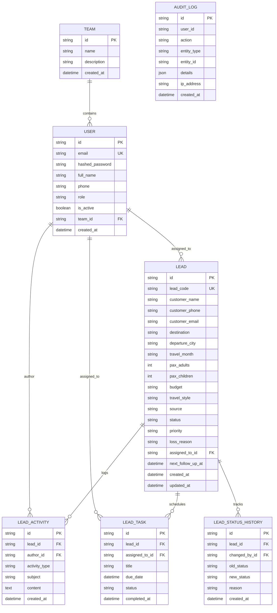

# Jeto Vacations CRM — Data Model & Schema

## Entity Relationship Overview

## Enum Definitions
- **UserRole**: `admin`, `manager`, `consultant`, `operations`
- **LeadStatus**: `new`, `assigned`, `contacted`, `qualified`, `proposal_sent`, `negotiating`, `won`, `lost`, `junk`
- **LeadPriority**: `urgent`, `high`, `medium`, `low`
- **LeadSource**: `callback_modal`, `website_enquiry`, `whatsapp`, `direct_call`, `referral`, `meta_ads`, `offline_walkin`
- **ActivityType**: `note`, `call`, `whatsapp`, `email`, `status_change`, `assignment`
- **TaskStatus**: `pending`, `completed`, `cancelled`
